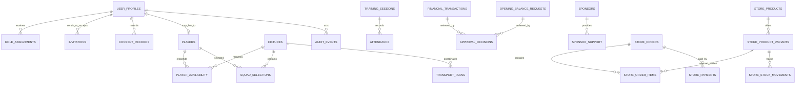

# Timau Union FC — Conceptual Data Model (Design Draft)

**Design only. This is not SQL and not a migration.**

## Principles
- One club per deployment.
- Supabase is the source of truth for identity and authorization.
- Represent money as integer KSh or a chosen exact numeric type, never floating point.
- Use Africa/Nairobi for club-facing scheduling.
- Enforce constraints and authorization server-side.
- Audit sensitive changes and approval decisions.
- Separate proposed, pending, approved, rejected and corrected/voided financial states.
- Never expose private records directly to public pages.

## Proposed entities

| Entity | Purpose |
|---|---|
| club_profile | Club name, location, approved crest/media and public contact settings |
| user_profiles | Authenticated identity and minimal profile fields |
| invitations | Invitee email, inviter, expiry, accepted/revoked state |
| role_assignments | User, role, assigner, validity and status |
| consent_records | Notice version, purpose, decision, timestamp and withdrawal |
| players | Player profile, linked user if applicable, status and approved football fields |
| player_availability | Player, fixture/session, response and timestamp |
| fixtures | Opponent, competition, venue, kickoff, status and confirmation source |
| squad_selections | Fixture, player, selection state and editor |
| training_sessions | Time, location, status and coach |
| attendance | Person, session/fixture, status and recorder |
| transport_plans | Fixture, needs, estimated/approved cost and status |
| financial_accounts | Club-defined categories, not personal bank credentials |
| financial_transactions | Amount, direction, category, date, evidence and state |
| opening_balance_requests | Proposed amount, evidence, proposer, reviewer, decision and reason |
| approval_decisions | Target, decision, actor, reason and timestamp |
| sponsors | Sponsor identity/contact fields, status and visibility |
| sponsor_support | Support type, pledge, receipt, restrictions and evidence |
| welfare_cases | Minimal sensitive information, restricted notes and authorized assignment |
| announcements | Draft/published state, author, approver and publication window |
| audit_events | Actor, action, target, timestamp and safe metadata |
| notification_preferences | User delivery preferences |
| store_products | Merchandise name, description, approved images, active status and catalogue visibility |
| store_product_variants | Product, size, colour, SKU/reference, price and stock quantity |
| store_orders | Order reference, customer contact/collection details, totals, fulfilment state and timestamps |
| store_order_items | Order, product/variant snapshot, quantity, unit price and customization text |
| store_payments | Order, method (M-Pesa/cash), amount, reference, status, verifier/receiver and timestamps |
| store_stock_movements | Variant, quantity change, reason, related order and actor for stock audit |

Names and relationships remain conceptual until schema design is approved.

## Relationship outline

## Club Store integrity and privacy
- Public visitors may read only active, publishable product information; customer orders and payment records are private.
- Never store M-Pesa PINs or payment credentials. A submitted payment reference remains unverified until an authorized verifier confirms it or an approved provider integration confirms it.
- Keep payment state separate from order fulfilment state.
- Store order-item snapshots of description/variant and price so later catalogue edits do not rewrite historical orders.
- Record stock movements and cancellations/refunds with actor, timestamp and reason; use server-side checks to prevent overselling and unauthorized stock changes.
- Restrict customer contact details to staff who need them for fulfilment/payment verification. Set retention and deletion rules before launch.
- Report merchandise sales separately from sponsorship pledges, transport support and welfare allocations until the club approves the accounting classification.

## Authorization
- Supabase Auth establishes identity; leadership-managed assignments control roles.
- Role assignment is validated server-side; users cannot grant themselves roles.
- Use deny-by-default RLS and carefully scoped server-side functions.
- Treasurer access does not imply welfare access, or vice versa.
- Media sees approved publishable content only.
- Sponsors/public receive explicitly published or shared fields only.
- Ordinary users cannot edit audit events; corrections preserve history.
- Never ship service-role credentials in browser code.

## Opening balance integrity
1. Save proposal and evidence as a request.
2. Exclude pending requests from approved totals.
3. Record approval/rejection and reason by an authorized reviewer.
4. Enforce separation of duties once the club confirms policy.
5. Derive approved summaries from approved transactions only.
6. Use traceable reversals/amendments rather than silent deletion.

Before implementation, confirm retention periods, data access/correction procedures, consent wording, safeguarding rules and whether minors may be represented.
