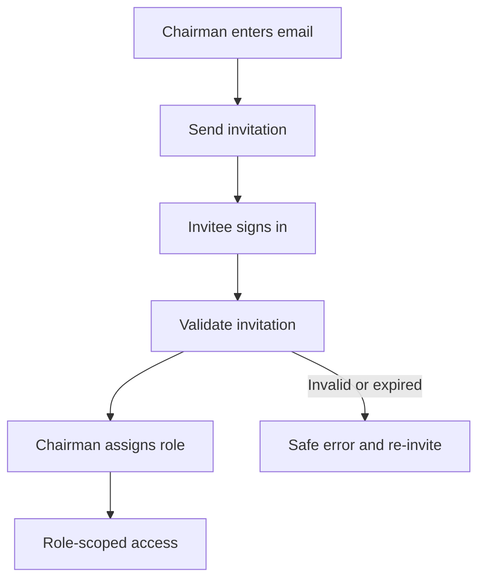
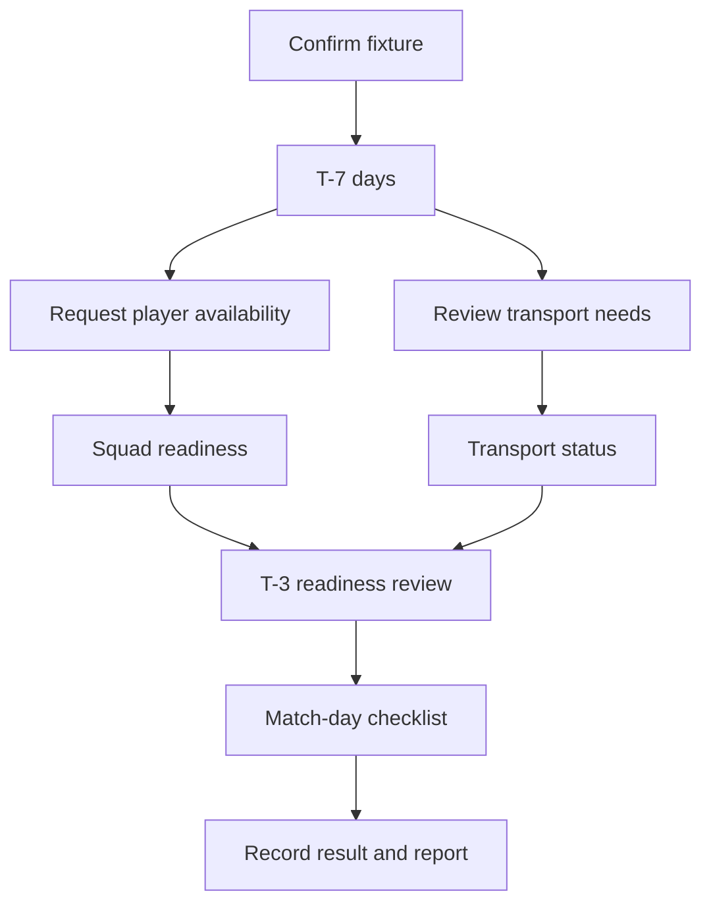
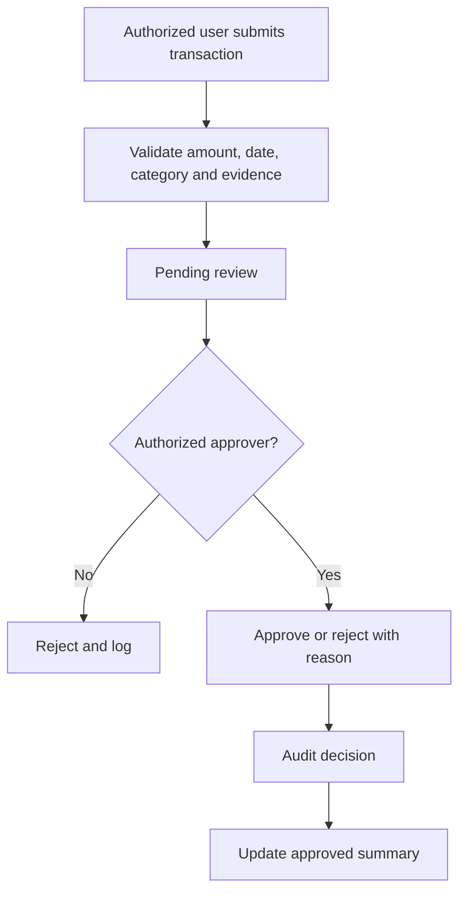
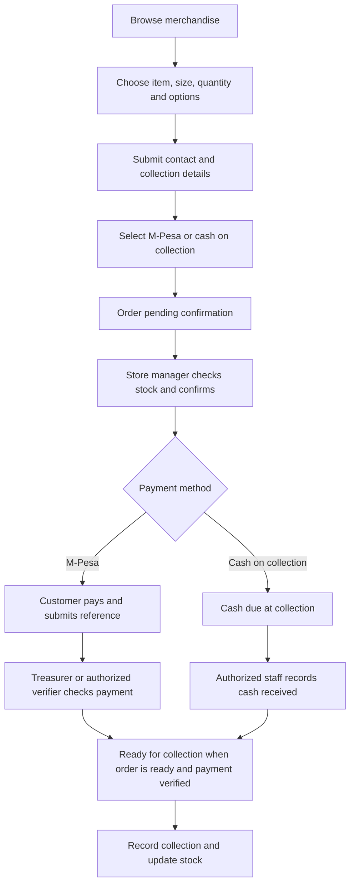

# Timau Union FC — Product Features & Flows (Design Draft)

**Status:** Design only; do not implement until the club approves.  
**Club:** Timau Union FC, Timau, Meru County, Kenya.  
**Platform:** Single-club mobile-first web app; GitHub Pages + Supabase.  
**Locale:** KSh; Africa/Nairobi timezone.

## Goals
- Coordinate football operations and club administration in one auditable system.
- Improve player availability and transport coordination before fixtures.
- Record income, expenses and opening balances transparently.
- Track sponsors and well-wisher support without promising unapproved payments.
- Publish approved public information while protecting player, welfare and financial data.
- Provide printable reports.

## Roles and intended access
- **Chairman:** club administration, invitations, role assignment and controlled approvals.
- **Vice Chairman:** delegated leadership and operational oversight.
- **Team Manager:** fixtures, squad availability and transport coordination.
- **Treasurer:** finance records, receipts, expenses and financial reports.
- **Secretary:** club records, meetings and administrative reports.
- **Coaches/technical staff:** training, squad and football operations.
- **Players:** own profile, availability, training and permitted fixture details.
- **Welfare officer:** restricted welfare workflow and minimum necessary information.
- **Media:** approved public content, fixtures/results and announcements.
- **Sponsors:** only information explicitly shared with them.
- **Public:** published club profile, approved fixtures/results and announcements.

The Chairman assigns roles after invitations. Job titles must not silently grant permissions. Supabase must enforce access; hiding a menu item is not security.

## Proposed modules
1. Role-aware dashboard.
2. Club profile, invitations, membership and roles.
3. Fixtures, results and match reports.
4. Squad and player availability.
5. Training and attendance.
6. Fixture-linked transport coordination.
7. Finance: income, expenses, receipts and opening balance.
8. Approvals and audit trail.
9. Restricted welfare.
10. Sponsors and well-wisher support.
11. Media, announcements and public page.
12. Permission-filtered printable reports.
13. **Club Store:** public merchandise catalogue, jersey/mesh sizing, orders, stock and sales reporting.

## Invitation flow

An invitation alone must not grant a privileged role. Users cannot assign roles to themselves.

## Fixture and transport readiness

Proposed reminders: T-7, T-3 and T+1. T-3 highlights unresolved transport needs. Confirm channels and scheduling before implementation.

## Finance and opening-balance lock

Opening balances remain pending and excluded from approved totals until approved. Distinguish pledged, received, pending, approved and rejected amounts. Corrections require a reason and audit trail.

## Club Store: merchandise, orders and payments
The Club Store sells official Timau Union FC mesh/jerseys first, with optional future items such as training kits, T-shirts, tracksuits, caps and scarves. Supporters can browse public products without a management account. Product pages show item, approved images, available sizes/colours, price, stock status and whether name/number printing is offered.

Proposed order flow:

- Payment status and fulfilment status are separate; submitting an order or an M-Pesa reference does not prove payment.
- Initial design supports recording and verifying M-Pesa payments and recording cash collected. Automated Daraja integration is a separate decision and must not be implied until credentials, callbacks, reconciliation and testing are approved.
- Stock is tracked by product variant (such as size and colour); avoid overselling by reserving/adjusting stock through an authorized server-side action.
- Store roles: store manager maintains catalogue, variants, stock and orders; treasurer verifies payments and reviews sales; club leadership sees reports and approves designated actions. Exact assignments require club approval.
- Record item price, quantity, discounts if allowed, payment reference, who verified/received payment, timestamps, order status and audit history. Refunds/cancellations and stock corrections require traceable reasons.
- Merchandise income, cost of merchandise and stock are reported distinctly from transport support, player welfare, sponsorship pledges and other club funds. Financial classification and accounting treatment must be approved by the club.
- Collect only contact/collection details needed to fulfil an order; limit access and define retention before launch.

## Privacy
- Explain collection purposes and access; obtain consent where required.
- Collect only data needed for club operations.
- Keep welfare notes, personal contacts and internal finance off public pages.
- Publish content only through an authorized workflow.
- Define retention and data-rights request procedures.
- Address Kenya Data Protection Act and safeguarding requirements before launch.
- Never expose private details through public endpoints or static payloads.

## Club decisions required
Approval matrix/thresholds; Club Store manager and payment-verifier assignments; stock reservation/cancellation and refund rules; whether M-Pesa is manual verification or automated Daraja integration; editable player fields; transport support states; sponsor login versus public updates; consent and retention wording; welfare escalation policy; verified Betika Cup dates/rules. Do not invent missing facts.
